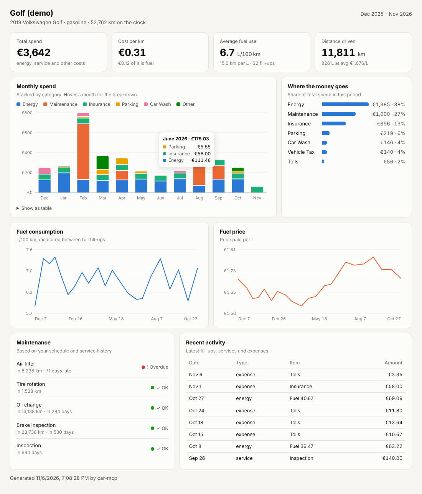

# car-mcp

An AI-native car logbook. Tell Claude "filled up 42 L for €71.30 at 52,300 km" or "what maintenance is due?" and it
logs, calculates and charts it for you. Built as an [MCP](https://modelcontextprotocol.io) server, so any MCP-capable
assistant can use it. Your data stays in a local SQLite file.



## What it does

| Area | Tools |
|---|---|
| Garage | `add_vehicle`, `list_vehicles`, `archive_vehicle`, `get_settings`, `update_settings` |
| Fuel & charging | `log_fill_up` (litres or kWh; consumption computed full-to-full, partial fills supported) |
| Maintenance | `log_service`, `set_maintenance_interval`, `get_maintenance_due` (by distance and/or months; sensible defaults for combustion and EV) |
| Other costs & trips | `log_expense` (insurance, tax, parking, tolls…), `log_trip` (personal/business/commute) |
| Insights | `get_summary` (total cost, cost per km, consumption, trips), `get_chart_data` (chart-ready series) |
| Car data | `lookup_official_consumption` (official WLTP kWh/100 km, L/100 km and CO2 of any model sold in Germany or the EU, from the [Allo Cars vehicle catalog](https://cars.allo.land/open-data/#vehicle-catalog); needs internet) |
| Dashboards | `show_dashboard` (interactive, renders inline in hosts that support [MCP Apps](https://modelcontextprotocol.io/specification/draft/extensions/apps)), `export_dashboard_html` (standalone file, works offline) |
| Housekeeping | `list_entries`, `delete_entry`, `load_demo_data` |
| Recalls (online) | `get_recalls` (EU Safety Gate incl. every KBA recall, and NHTSA), `check_used_car` (recalls for a used car's build window, recall codes and what to ask the seller), `get_recall_statistics` (per year, component and brand per 100,000 new cars) from [cars.allo.land](https://cars.allo.land/recalls/) |
| Prices (online) | `get_fuel_prices` (weekly petrol, diesel and LPG prices since 2005 from [cars.allo.land](https://cars.allo.land/fuel-prices/)) |

Prompts: `monthly_report` (spend, anomalies, upcoming maintenance) and `log_receipt` (log from a receipt photo or text).

The dashboard is a single self-contained HTML file: no CDN, light and dark mode, hover tooltips, a table view of the
monthly chart, and phone-width layout.

## Install

Requires [uv](https://docs.astral.sh/uv/).

### Claude Desktop

Add to `claude_desktop_config.json` (Settings → Developer → Edit Config):

```json
{
  "mcpServers": {
    "car": {
      "command": "uvx",
      "args": ["--from", "git+https://github.com/spikinglabs/cars", "car-mcp"]
    }
  }
}
```

### Claude Code

```bash
claude mcp add car -- uvx --from git+https://github.com/spikinglabs/cars car-mcp
```

### Remote (claude.ai custom connector, other clients)

```bash
uvx --from git+https://github.com/spikinglabs/cars car-mcp --http --host 0.0.0.0 --port 8765
# MCP endpoint: http://<host>:8765/mcp
```

The HTTP mode has no authentication yet. Only expose it behind something that adds auth (a tunnel with access control,
a reverse proxy, etc.).

### Options

| | |
|---|---|
| `--db PATH` / `CAR_MCP_DB` | SQLite file (default `~/.car-mcp/car.db`) |
| `--http`, `--host`, `--port` | Serve streamable HTTP instead of stdio |
| `--demo-dashboard OUT.html` | Write a dashboard with demo data and exit |

## Try it

Once connected, ask Claude:

- "Load the demo data and show me the dashboard."
- "Add my car: 2019 VW Golf, petrol, currently at 52,000 km."
- "Filled up 41.2 L for €70.10 at 52,640 km."
- "Oil change today at 52,700 km, €189 at Autohaus Müller."
- "What maintenance is coming up?"
- "How much did the car cost me this year, and what's my cost per km?"
- "Use the monthly_report prompt."

## Development

```bash
uv venv && uv pip install -e . pytest
.venv/bin/pytest
```

Layout:

- `src/car_mcp/garage.py`: domain logic and analytics (no MCP dependency, easy to reuse)
- `src/car_mcp/db.py`: SQLite schema
- `src/car_mcp/server.py`: MCP tools, prompts and the MCP Apps dashboard resource
- `src/car_mcp/dashboard.html`: the dashboard UI (standalone or MCP App)
- `src/car_mcp/sample.py`: deterministic demo data
